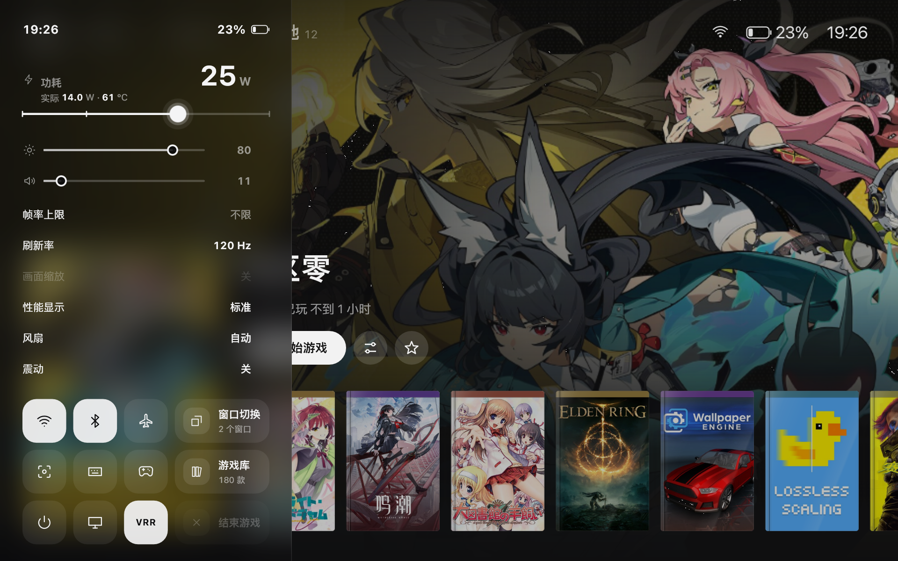
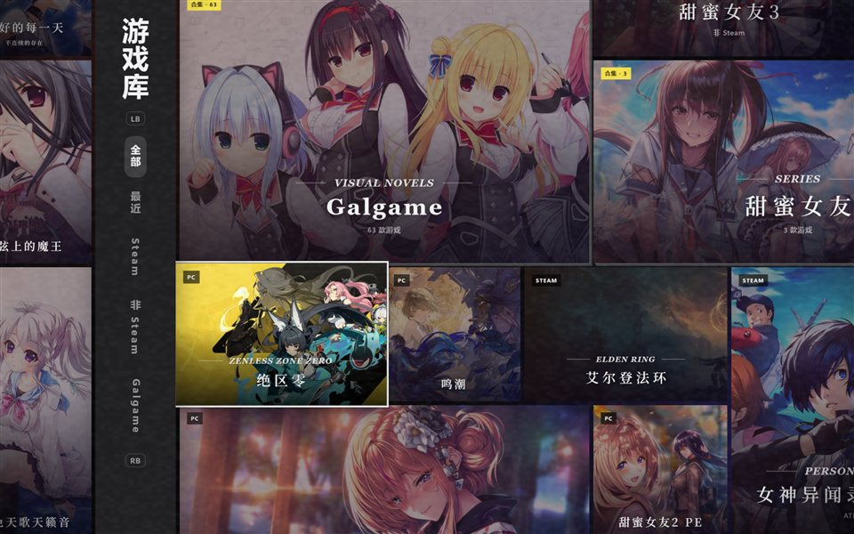

<p align="center">
  
</p>

# Playrail

**面向 MSI Claw 的 Windows 掌机游戏库与游戏内控制面板。** 用手柄浏览和启动 Steam、本地游戏。在游戏里打开快捷面板，调节功耗、亮度或音量，连接网络，切换到另一个窗口。

*A native Windows game library and in-game control panel for MSI Claw handhelds.*

[功能](#功能) · [安装与升级](#安装与升级) · [兼容性](#兼容性) · [源码构建](#源码构建) · [开发资料](#开发资料)



## 功能

| 场景 | 能做什么 |
| --- | --- |
| **找游戏** | 用手柄、触屏或鼠标浏览封面墙，搜索游戏，查看 Steam 分类并启动 Steam 游戏或本地快捷方式。 |
| **游戏中快速操作** | 通过快捷面板（QAM）调节功耗、亮度、音量、帧率上限、刷新率、VRR、风扇和震动。打开 Wi-Fi／蓝牙列表、截图、唤出键盘、切换窗口或返回游戏库。 |
| **调性能与画面** | 调节 TDP 与 CPU 频率，按游戏配置性能选项，使用性能叠加层（OSD）查看帧率和硬件读数。窗口游戏可用修改版 Magpie 放大，并选用 FSR、Anime4K、RCAS 等效果。 |
| **切换游戏和桌面** | 用 ClawShell 在游戏模式与 Windows 桌面之间切换，可选择是否保留 Explorer。电源菜单提供睡眠、重启、关机和对应过渡动画。 |
| **配置掌机输入** | 为 Claw 特殊按键设置动作，配置手柄或键鼠映射。Steam 大屏幕也可使用菜单路由与导航震动。 |
| **继续用 Steam 大屏幕** | 可选的 Decky 插件提供快捷工具、添加非 Steam 游戏、Clash Verge 控制和针对个别游戏的兼容性修复。 |

<details>
<summary>查看原生封面墙截图</summary>



</details>

## 安装与升级

当前仓库提供源码。原生安装需要带后台组件的已签名 x64 MSIX，游戏库版本至少为 **0.1.265.0**。当前源码的包版本为 **0.1.267.0**。本地签名包需要 Windows 已信任与包匹配的签名证书。

在仓库根目录打开 PowerShell，把命令里的路径改成手头的安装包路径。

```powershell
$msix = 'C:\path\to\ClawLibrary_0.1.267.0_x64.msix'
.\install.ps1 -LibraryMsix $msix -NativeOnly
```

1. 同意后台安装的管理员权限提示。安装器会配置随包提供的 Agent 和其他后台组件。
2. 从开始菜单打开 **Claw 游戏库**。已有安装可用同一条命令原地升级，保留应用包身份和本地设置。
3. 已装新版游戏库时，可在「设置 → 维护 → 安装或更新后台」重新运行随包的后台安装。

**Decky 入口**适用于已运行 Decky Loader 的 Windows Steam 大屏幕或 Playhub Gaming。先构建插件前端和原生组件，再用 [安装脚本](install.ps1) 配置。与原生游戏库共用后台时，安装命令可以同时传入 `-LibraryMsix` 并省略 `-NativeOnly`。

如果后台安装失败，检查 `%LOCALAPPDATA%\ClawToolbox\setup` 内的 `install.log` 和对应的 `status-<运行编号>.json`。最近一次成功安装的组件版本记录在 `backend.json`。

## 兼容性

- **主要设备**为 MSI Claw 8 EX AI+。原生包面向 x64，项目的快捷面板和窗口切换验证记录使用 MSI Claw 与 Windows 11 25H2。功耗、风扇和特殊按键依赖设备与驱动。 [验证记录](frontend/QAM/verification-0.1.245.md)
- **性能与风扇**需要相应的后台权限和硬件支持，部分调节依赖 PawnIO。VRR、刷新率和驱动限帧选项取决于显示器与驱动。 [性能功能说明](docs/performance-page-features.md)
- **无线设备**的连接能力取决于 Windows、适配器和设备类型。经典蓝牙音频和由驱动持有的 HID 连接由系统管理。Wi-Fi 实际连接和实体设备配对还有待扩大验证。 [无线验证范围](frontend/QAM/verification-0.1.245.md)
- **游戏模式恢复**可用登录时按住 Shift 的方式回到桌面。遇到黑屏，可用 Ctrl+Alt+Del 打开任务管理器并运行 `explorer.exe`。 [游戏模式与恢复流程](docs/game-mode.md)

## 源码构建

| 目标 | 环境 |
| --- | --- |
| Decky 前端与后台辅助程序 | Windows x64、.NET Framework 4.x 的 `csc.exe`、.NET 9 SDK、Python 3.12 和 Node.js。 |
| 原生游戏库 MSIX | .NET 9 SDK、带 MSVC x64 的 Visual Studio Build Tools、Windows SDK、`CurrentUser\My` 中主题为 `CN=ClawToolbox` 的签名证书，以及准备齐全的 Payload。 |
| 修改版 Magpie | Visual Studio 2022 Build Tools、桌面 C++、UWP C++ 与 Windows SDK 26100。 |

```powershell
# 仅构建 Decky 前端
.\build.ps1 -FrontendOnly

# 首次构建后台，替换为本机的 Python 3.12 路径
.\build.ps1 -Python 'C:\path\to\python.exe'
.\test.ps1

# 从源码单独构建缩放组件
.\build-magpie.ps1
```

原生包使用 [Build-Msix.ps1](frontend/library-native/tools/Build-Msix.ps1)，输出到 `frontend/library-native/AppPackages/`。完整 MSIX 还需要当前版本的 ClawShell、游戏会话、Agent、Game Bar 小组件、PawnIO、风扇服务及睡眠组件。 [Payload 收集脚本](frontend/library-native/tools/Stage-OobePayload.ps1) 从已准备的本机组件收集所需文件，构建脚本会检查缺失文件及外壳版本。

[package.ps1](package.ps1) 将 Decky 插件打包到 `artifacts/`。它依赖生成的运行时、辅助程序及本机准备的 `plugin/resources/clawtweaks-home.patch.gz`。这些构建输入与输出由本地环境准备。

## 开发资料

| 目录 | 职责 |
| --- | --- |
| [frontend/library-native/](frontend/library-native/) | WinUI 3、Composition、NativeAOT 游戏库，包含快捷面板、控制中心与单游戏设置。 |
| [frontend/library/](frontend/library/) | TypeScript 网页版游戏库原型。 |
| [plugin/](plugin/) | JavaScript Decky 前端与 Python 后台 Agent。 |
| [native/](native/) | C# 输入、功耗、外壳和睡眠组件，C++/WinRT Game Bar 小组件，以及修改版 Magpie。 |
| [tests/](tests/) 与 [tools/](tools/) | 回归测试、构建、安装与诊断脚本。 |

- [原生游戏库开发记录](docs/native-library/README.md)
- [快捷面板验证与场景覆盖](frontend/QAM/verification-0.1.245.md)
- [Game Bar 小组件功能](docs/gamebar-widget-features.md)
- [增强睡眠与唤醒](docs/enhanced-sleep-20261029.md)

## 许可

本项目自有代码采用 MIT 许可。修改版 Magpie 源码及其编译程序采用 GPL-3.0。其他依赖及其许可见第三方声明。 [MIT](LICENSE) · [Magpie 许可](native/upstream/Magpie-0.12.1/LICENSE) · [第三方声明](native/Scaling/THIRD_PARTY_NOTICES.md)
