<p align="center"></p>
<h1 align="center">Playrail</h1>
<p align="center"><strong>面向 MSI Claw 的原生 Windows 游戏库与游戏内控制面板</strong></p>
<p align="center">用手柄挑选和启动游戏。需要调整功耗、切换窗口或连上网络时，从游戏内直接打开快捷面板。</p>
<p align="center"><a href="#界面导览">界面导览</a> · <a href="#安装与升级">安装与升级</a> · <a href="#兼容性">兼容性</a> · <a href="#源码构建">源码构建</a></p>


## 界面导览

| 想了解 | 主要入口 |
| --- | --- |
| 浏览和启动游戏 | [游戏库与控制中心](#游戏库与控制中心) |
| 游戏中调亮度、连接网络 | [快捷面板与无线连接](#快捷面板与无线连接) |
| 看帧率、调功耗和缩放 | [性能监控与画面](#性能监控与画面) |
| 改按键、在应用之间切换 | [手柄映射与窗口切换](#手柄映射与窗口切换) |
| 切换游戏模式、睡眠与唤醒 | [游戏模式与电源管理](#游戏模式与电源管理) |
| 在 Xbox Game Bar 或 Steam 大屏幕里使用 | [Game Bar 与 Steam 大屏幕](#game-bar-与-steam-大屏幕) |

下方为不同开发版本的界面记录，点击截图可查看大图。Wi-Fi 与蓝牙截图使用测试数据，睡眠与唤醒以动画关键帧展示。

### 游戏库与控制中心

游戏库把 Steam、当前 Windows 用户已安装的 Xbox／Microsoft Store 游戏和本地游戏放在同一面封面墙上。可以按来源浏览、打开 Steam 合集，也可以按名称搜索。选中卡片后可启动游戏或进入单游戏设置。

控制中心汇集游戏库、性能、电源等常用入口。主要界面支持手柄导航，也支持触屏点击、滑动和滚动。

| 游戏库搜索结果 | 控制中心 |
| --- | --- |
| <a href="docs/native-library/search-results.jpg">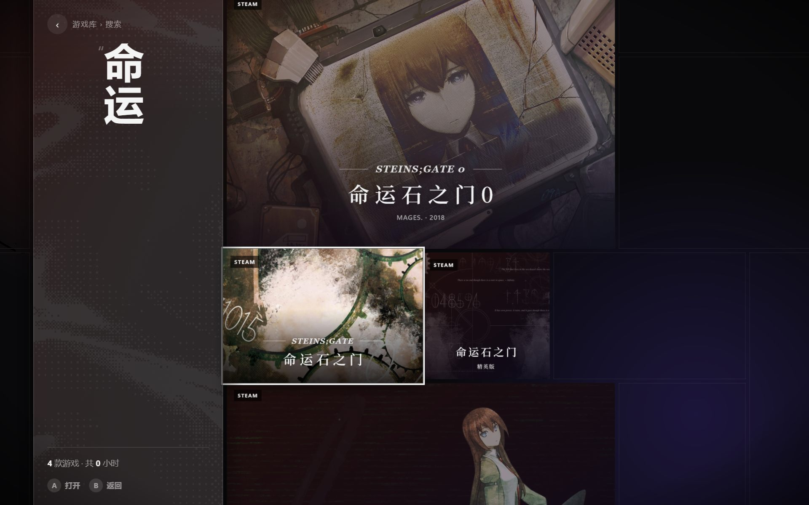</a> | <a href="docs/native-library/control-center.jpg">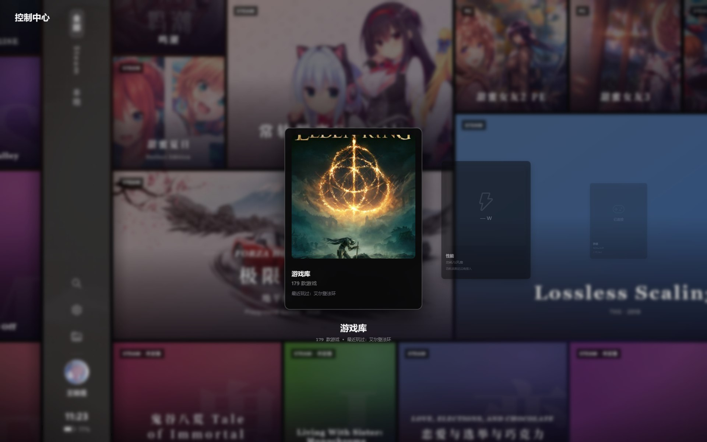</a> |

### 快捷面板与无线连接

快捷面板（QAM）从画面左侧打开。上半部是功耗、亮度、音量和显示设置，下半部可以截图、唤出键盘、切换手柄模式、切换窗口或返回游戏库。帧率上限、刷新率、VRR、风扇和震动都可以在这里调节。

[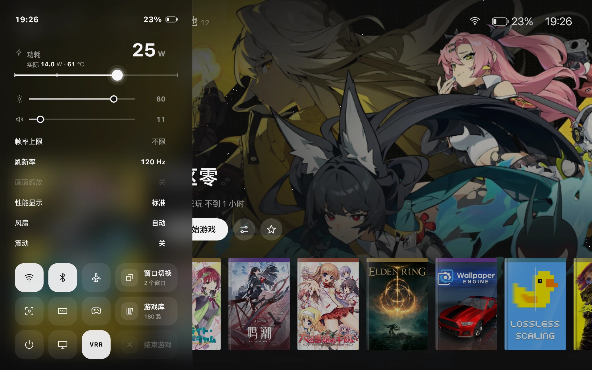](docs/screenshots/quick-access.png)

Wi-Fi 与蓝牙各有独立列表。Wi-Fi 页面可选择网络并用屏幕键盘输入密码。蓝牙页面显示已知和可配对的设备，支持的设备会显示配对确认或电量。 [无线功能验证范围](frontend/QAM/verification-0.1.245.md)

| Wi-Fi 密码与屏幕键盘 | 蓝牙设备与配对确认 |
| --- | --- |
| <a href="docs/screenshots/qam-wifi-keyboard.webp">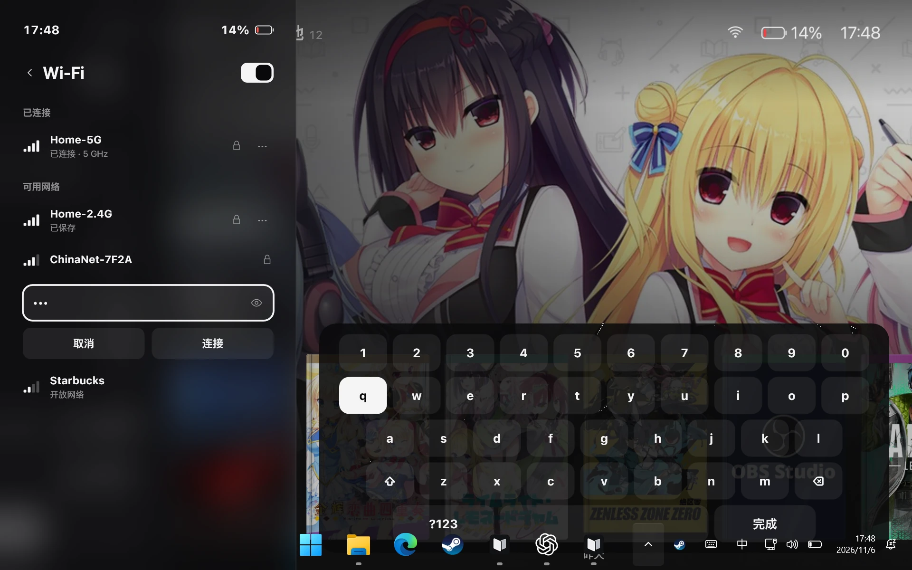</a> | <a href="docs/screenshots/qam-bluetooth-pairing.webp">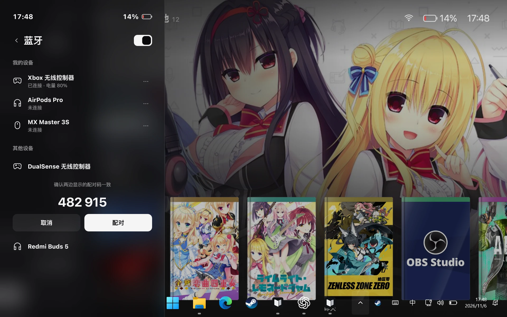</a> |

### 性能监控与画面

- **功耗档案**可按游戏设置固定功耗、区分插电和电池，或按目标帧率自动调节。也可统一使用全局设置。
- **性能叠加层（OSD）**可从单个 FPS 数字切换到详细监控，查看帧时间、CPU／GPU 和电池读数，并调整位置、字号与缩放。
- **画面缩放**可用修改版 Magpie 将窗口游戏铺满屏幕，选择 FSR、Anime4K 等效果或追加 RCAS 锐化。已安装 Lossless Scaling 的用户也可以从 Playrail 配置本机的缩放与插帧档案。

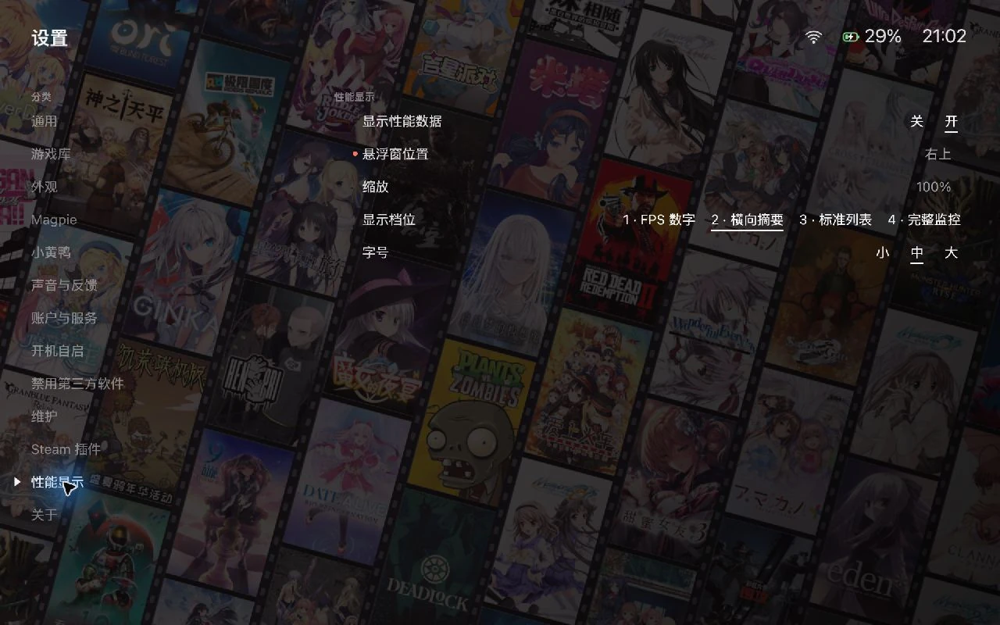

[性能功能说明](docs/performance-page-features.md) · [缩放设置说明](docs/scaling-settings-20261023.md)

### 手柄映射与窗口切换

手柄可使用全局映射，也可为单个游戏单独保存。比如，把 Claw 的 M1 背键设为键盘组合键，或针对一枚按键配置触发延迟。手柄页还提供摇杆、扳机与震动设置。

| 单游戏按键映射 | 按键触发设置 |
| --- | --- |
| <a href="docs/screenshots/per-game-controller.webp">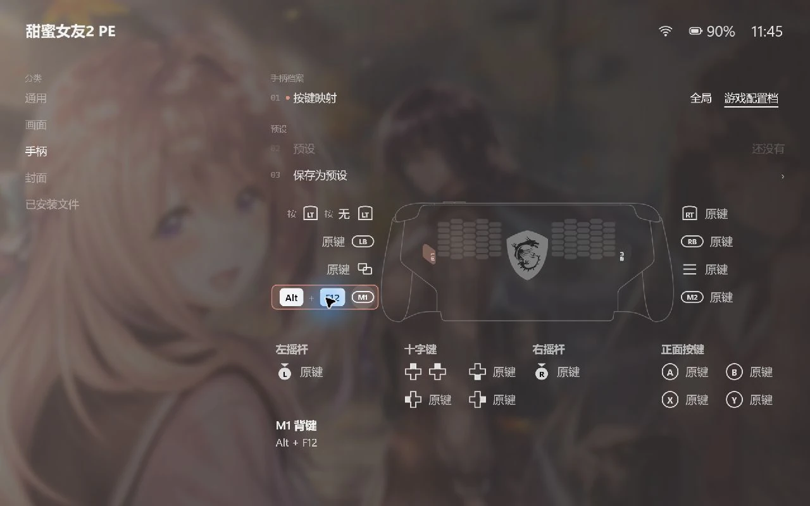</a> | <a href="docs/screenshots/controller-trigger-settings.webp">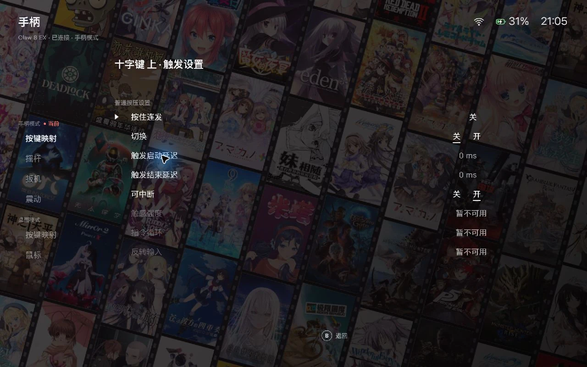</a> |

从快捷面板打开窗口切换器，可以用卡片选择已打开的游戏或应用，再切回正在游玩的窗口。截图页可以按时间浏览 Steam 和本地捕获内容，也能按游戏筛选。 [窗口切换验证记录](frontend/QAM/verification-0.1.245.md)

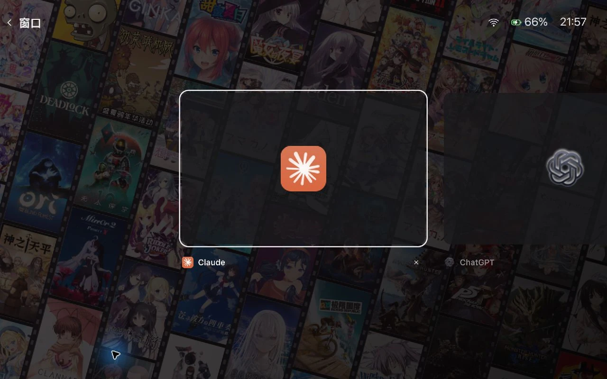

### 游戏模式与电源管理

ClawShell 支持从全屏游戏界面切到 Windows 桌面，也可以设置登录后直接进入游戏模式。游戏模式有保留 Explorer 的选项。系统页可查看电量、预计使用时间和设备信息，并配置充电上限、电源键行为与睡眠选项。

| 切到游戏模式 | 电池与电源设置 |
| --- | --- |
| <a href="docs/screenshots/game-mode-transition.webp">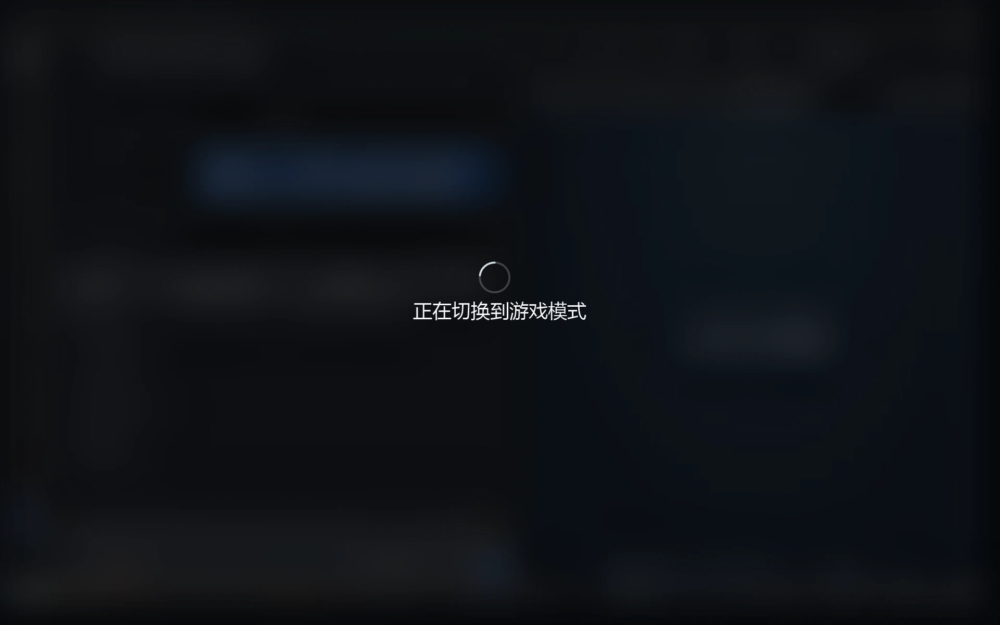</a> | <a href="docs/screenshots/system-power-settings.webp">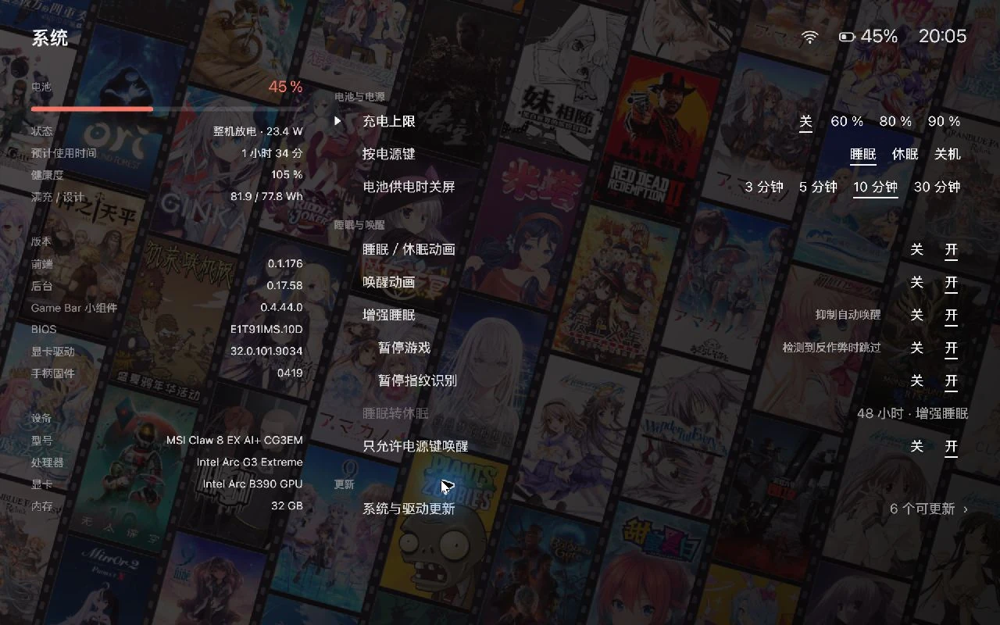</a> |

睡眠与唤醒动画可分别启用。增强睡眠可选择在睡眠时暂停游戏，在已识别的反作弊场景会跳过暂停。 [增强睡眠说明](docs/enhanced-sleep-20261029.md)

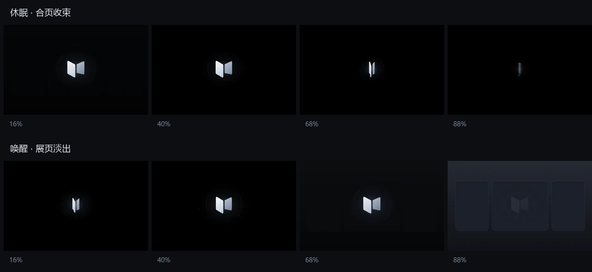

### Game Bar 与 Steam 大屏幕

习惯 Windows 桌面游戏的用户可使用 Xbox Game Bar 小组件来调功耗、亮度、音量等。Steam 大屏幕／Playhub Gaming 则可接入可选的 Decky 插件，用于添加非 Steam 游戏、映射特殊键、开启导航震动、管理本机 Clash Verge 和使用个别游戏的兼容性修复。

| Xbox Game Bar 小组件 | Steam 大屏幕中的 Decky 插件 |
| --- | --- |
| <a href="docs/screenshots/gamebar-widget.webp">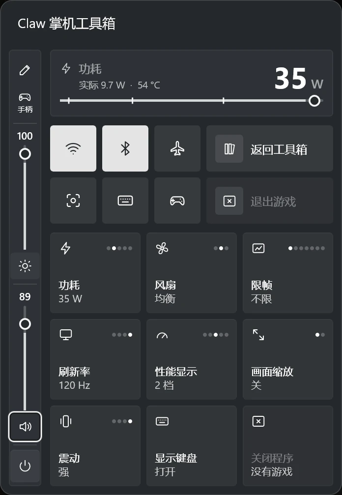</a> | <a href="docs/screenshots/decky-add-game.webp">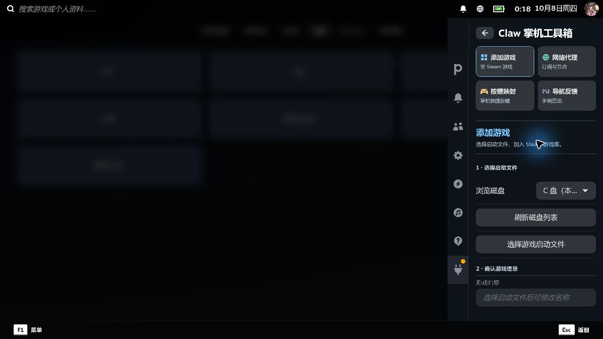</a> |

## 安装与升级

当前仓库提供源码。原生安装需要带后台组件的已签名 x64 MSIX，游戏库版本至少为 **0.1.265.0**。当前源码的包版本为 **0.1.267.0**。本地签名包需要 Windows 已信任与包匹配的签名证书。

在仓库根目录打开 PowerShell，把命令里的路径改成手头的安装包路径。

```powershell
$msix = 'C:\path\to\ClawLibrary_0.1.267.0_x64.msix'
.\install.ps1 -LibraryMsix $msix -NativeOnly
```

1. 同意后台安装的管理员权限提示。安装器会配置随包提供的 Agent 和其他后台组件。
2. 从开始菜单打开 **Claw 游戏库**。已有安装可用同一条命令原地升级，保留应用包身份和本地设置。
3. 已装新版游戏库时，可在「设置 → 维护 → 安装或更新后台」重新运行随包的后台安装。

<details>
<summary>查看首次设置界面</summary>

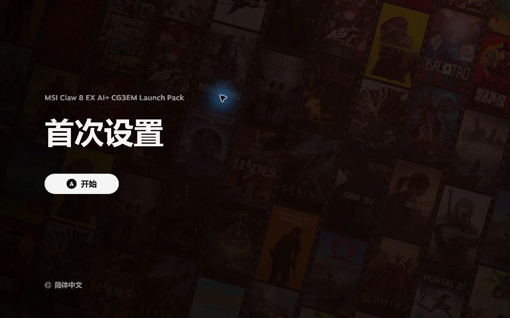

</details>

**Decky 入口**适用于已运行 Decky Loader 的 Windows Steam 大屏幕或 Playhub Gaming。先构建插件前端和原生组件，再用 [安装脚本](install.ps1) 配置。与原生游戏库共用后台时，安装命令可以同时传入 `-LibraryMsix` 并省略 `-NativeOnly`。

如果后台安装失败，检查 `%LOCALAPPDATA%\ClawToolbox\setup` 内的 `install.log` 和对应的 `status-<运行编号>.json`。最近一次成功安装的组件版本记录在 `backend.json`。

## 兼容性

- **主要设备**为 MSI Claw 8 EX AI+。原生包面向 x64，项目的快捷面板和窗口切换验证记录使用 MSI Claw 与 Windows 11 25H2。功耗、风扇和特殊按键依赖设备与驱动。 [验证记录](frontend/QAM/verification-0.1.245.md)
- **性能与风扇**需要相应的后台权限和硬件支持，部分调节依赖 PawnIO。VRR、刷新率和驱动限帧选项取决于显示器与驱动。 [性能功能说明](docs/performance-page-features.md)
- **无线设备**的连接能力取决于 Windows、适配器和设备类型。经典蓝牙音频和由驱动持有的 HID 连接由系统管理。Wi-Fi 实际连接和实体设备配对还有待扩大验证。 [无线验证范围](frontend/QAM/verification-0.1.245.md)
- **游戏模式恢复**可用登录时按住 Shift 的方式回到桌面。遇到黑屏，可用 Ctrl+Alt+Del 打开任务管理器并运行 `explorer.exe`。 [游戏模式与恢复流程](docs/game-mode.md)

## 源码构建

| 目标 | 环境 |
| --- | --- |
| Decky 前端与后台辅助程序 | Windows x64、.NET Framework 4.x 的 `csc.exe`、.NET 9 SDK、Python 3.12 和 Node.js。 |
| 原生游戏库 MSIX | .NET 9 SDK、带 MSVC x64 的 Visual Studio Build Tools、Windows SDK、`CurrentUser\My` 中主题为 `CN=ClawToolbox` 的签名证书，以及准备齐全的 Payload。 |
| 修改版 Magpie | Visual Studio 2022 Build Tools、桌面 C++、UWP C++ 与 Windows SDK 26100。 |

```powershell
# 仅构建 Decky 前端
.\build.ps1 -FrontendOnly

# 首次构建后台，替换为本机的 Python 3.12 路径
.\build.ps1 -Python 'C:\path\to\python.exe'
.\test.ps1

# 从源码单独构建缩放组件
.\build-magpie.ps1
```

原生包使用 [Build-Msix.ps1](frontend/library-native/tools/Build-Msix.ps1)，输出到 `frontend/library-native/AppPackages/`。完整 MSIX 还需要当前版本的 ClawShell、游戏会话、Agent、Game Bar 小组件、PawnIO、风扇服务及睡眠组件。 [Payload 收集脚本](frontend/library-native/tools/Stage-OobePayload.ps1) 从已准备的本机组件收集所需文件，构建脚本会检查缺失文件及外壳版本。

[package.ps1](package.ps1) 将 Decky 插件打包到 `artifacts/`。它依赖生成的运行时、辅助程序及本机准备的 `plugin/resources/clawtweaks-home.patch.gz`。这些构建输入与输出由本地环境准备。

## 开发资料

| 目录 | 职责 |
| --- | --- |
| [frontend/library-native/](frontend/library-native/) | WinUI 3、Composition、NativeAOT 游戏库，包含快捷面板、控制中心与单游戏设置。 |
| [frontend/library/](frontend/library/) | TypeScript 网页版游戏库原型。 |
| [plugin/](plugin/) | JavaScript Decky 前端与 Python 后台 Agent。 |
| [native/](native/) | C# 输入、功耗、外壳和睡眠组件，C++/WinRT Game Bar 小组件，以及修改版 Magpie。 |
| [tests/](tests/) 与 [tools/](tools/) | 回归测试、构建、安装与诊断脚本。 |

- [原生游戏库开发记录](docs/native-library/README.md)
- [快捷面板验证与场景覆盖](frontend/QAM/verification-0.1.245.md)
- [Game Bar 小组件功能](docs/gamebar-widget-features.md)
- [增强睡眠与唤醒](docs/enhanced-sleep-20261029.md)

## 许可

本项目自有代码采用 MIT 许可。修改版 Magpie 源码及其编译程序采用 GPL-3.0。其他依赖及其许可见第三方声明。 [MIT](LICENSE) · [Magpie 许可](native/upstream/Magpie-0.12.1/LICENSE) · [第三方声明](native/Scaling/THIRD_PARTY_NOTICES.md)
