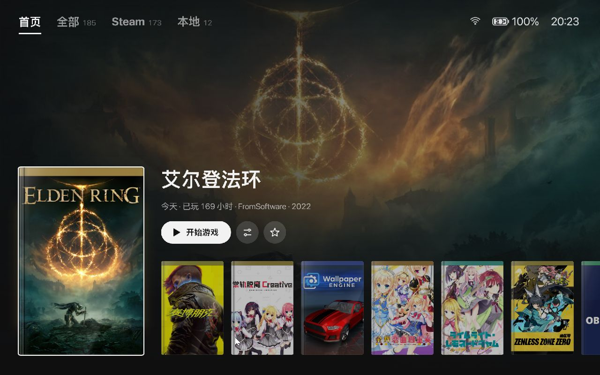
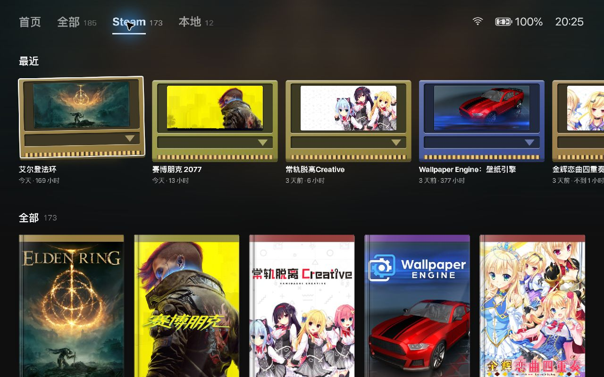
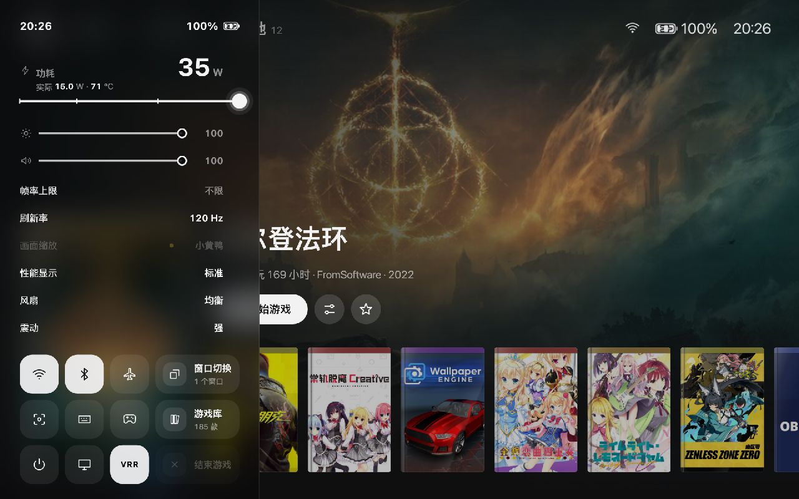
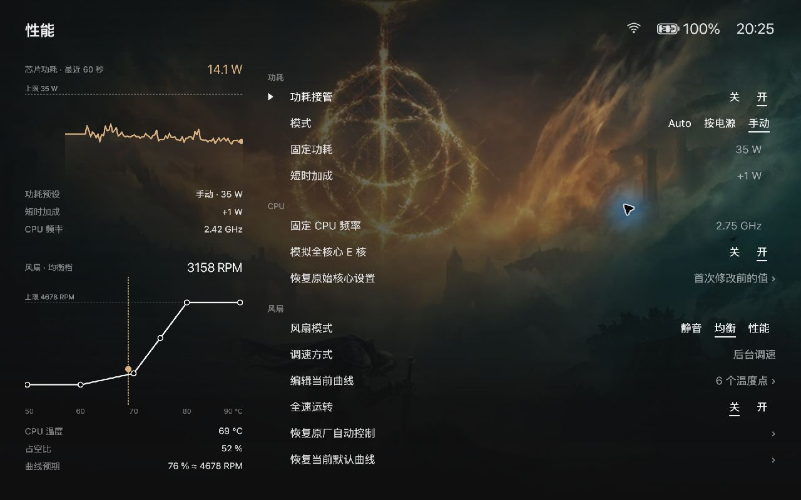
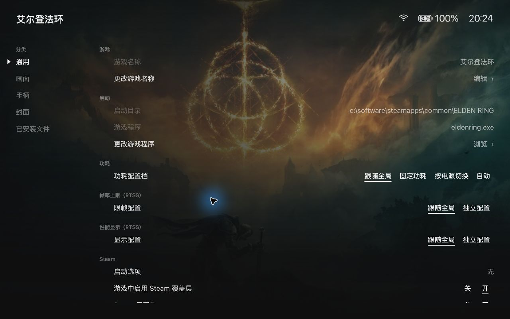

<p align="center"></p>
<h1 align="center">Playrail</h1>
<p align="center">MSI Claw 掌机上的手柄游戏界面，用来代替 Windows 桌面、MSI Center M 和 ClawTweaks。</p>
<p align="center"><a href="https://github.com/jinyuwang724-hue/playrail/releases">下载</a> · <a href="#安装">安装</a> · <a href="#功能说明">功能说明</a> · <a href="#限制与已知问题">限制</a></p>



## 为什么做这个

MSI Claw 跑的是完整的 Windows 11。拿它当游戏机用，会碰到几件麻烦事：

- 开机先进桌面。Steam、Xbox 应用和散装的本地游戏各在各的地方，没有一个能用手柄统一挑游戏的入口。
- 调功耗要开 MSI Center M，调风扇、限帧、画面缩放又分散在 ClawTweaks、RTSS、Magpie、Lossless Scaling 等好几个程序里，很多界面用手柄点不动。
- 这些设置都是全局的。一款游戏要 25 W 加 60 帧上限，另一款 12 W 就够，每次开游戏都得手动改。

Playrail 把这些放进一套界面：开机直接进游戏库，游戏里按快速设置键打开左侧面板调功耗和画面，每款游戏可以记住自己的功耗、限帧、性能显示、手柄映射和缩放方式，启动时自动切换。全部操作都能用手柄完成，触屏也能用。

## 先看这几点

1. **游戏模式不启动资源管理器。** 游戏库直接作为 Windows 外壳运行，开机落在游戏库，没有任务栏和桌面在后台占资源。需要桌面时按住手柄「视图 + 菜单」2 秒切过去，不用重启。
2. **硬件直接控制，不依赖 MSI 的软件。** 功耗上限通过 CPU 寄存器写入，风扇曲线写进嵌入式控制器，手柄映射写进手柄固件。装好以后可以把 MSI Center M、ClawTweaks 的自启关掉，Playrail 在设置里提供这个开关，随时能恢复。
3. **按游戏保存设置。** 进入游戏卡片的设置页，功耗、限帧、性能显示、手柄布局、Magpie 缩放、Lossless Scaling 各自可以选择「跟随全局」或单独配置。
4. **游戏中只需要一个面板。** 游戏模式下用快速设置键打开左侧快捷面板；在 Windows 桌面或 Steam 大屏幕里，用 Xbox Game Bar 里的 Playrail 小组件，两边的功能基本一致。

## 功能说明

以下内容以当前代码和 1.0 Beta 2 安装包为准。截图来自开发版 0.1.267，安装包改用 Windows 系统字体，字形会和截图略有不同。

### 游戏库



- **游戏来源**：本机 Steam 账户的已装游戏和非 Steam 快捷方式、Xbox / Microsoft Store 已装游戏、手动添加的单个游戏，以及指定的游戏文件夹（每个子文件夹算一款，自动挑出主程序，排除安装和卸载程序）。
- **Steam 云端游戏库**：填入自己的 Steam Web API Key 后，也能列出已购买但没安装的游戏，从游戏库直接装。
- **添加本地游戏**：选好 exe 后自动去 Steam 和 SteamGridDB 找封面、背景、徽标和图标，可以手动换图。加好的游戏可以一键写入 Steam 的非 Steam 快捷方式，两边用同一个 ID，不会出现两份。
- **浏览**：按 Steam、本地等集合分开浏览，集合可以隐藏和排序；支持搜索、收藏、隐藏游戏；显示最近游玩时间和累计时长。
- **外观**：背景可选封面墙、海报和本地壁纸，可调动态效果、海报叠色和灯光；标题有电影字幕、极简黑体等样式。闲置后进入屏幕保护。
- **声音**：界面音效（三套风格，可调音量）和三首原创主页背景音乐，也能导入自己的音乐。启动游戏时音乐淡出。
- **界面语言**：简体中文和英文。

### 游戏模式

由 ClawShell 接管登录后的 Windows 外壳：不启动 explorer，代为运行开机自启项，拉起游戏库并在它崩溃时重启。

- **切换**：控制中心的电源菜单、桌面上的「返回游戏模式」快捷方式，或任何时候按住「视图 + 菜单」2 秒。只启停 explorer，游戏库一直在。
- **窗口切换**：游戏模式没有任务栏。长按快速设置键打开窗口切换器，显示所有窗口的实时缩略图，可以切过去或请求关闭。
- **出问题时**：登录时按住 Shift 或「视图 + 菜单」直接进桌面；游戏库 60 秒内连续 3 次起不来，或 ClawShell 自己出错，都会自动恢复资源管理器。实在黑屏，按 Ctrl+Alt+Del 打开任务管理器，运行 `explorer.exe`。详见[游戏模式说明](docs/system/game-mode.md)。

### 游戏中的快捷面板



在游戏模式里短按快速设置键，从左侧滑出。游戏画面保留在右边，不会切走。

- **顶部**：功耗滑条（同时显示实际功耗和 CPU 温度）、亮度、音量。
- **中间**：帧率上限、刷新率、画面缩放（Magpie 或 Lossless Scaling）、性能显示档位、风扇模式、震动强度，左右键直接改值。
- **磁贴**：Wi-Fi、蓝牙、飞行模式、窗口切换、截图、屏幕键盘、手柄 / 键鼠模式切换、回到游戏库、电源、回到桌面、VRR、结束游戏。Wi-Fi 和蓝牙可以进二级页选网络和设备。

### Game Bar 小组件

在 Windows 桌面或 Steam 大屏幕里用。安装时会注册为 Game Bar 的首个 OEM 小组件，可以设成按 Xbox 键直接打开。

- 主页和快捷面板类似：功耗、亮度、音量，8 个快捷操作和 3×3 快捷磁贴（可以自己挑选和排列）。
- **Magpie 页**：缩放模式、捕获方式、3D 游戏模式、帧率限制、光标缩放与插值、自动隐藏光标、捕获标题栏、上下左右裁剪、多显示器处理等原版 Magpie 的配置项，改完返回游戏后生效。
- **Lossless Scaling 页**：帧生成、缩放算法、锐化、同步模式、最大帧延迟等，左右键直接写入当前游戏的配置。
- 性能显示可设档位、位置和字号；也能冻结游戏、退出游戏、打开任务管理器。

### 性能、功耗和风扇



- **功耗模式**：固定功耗；按插电 / 电池切换两套功耗；自动模式（设定目标帧率，在功耗上下限之间按实际帧率增减功耗）。手动范围 8–35 W，可加短时功耗加成。
- **CPU**：频率上限；把全部核心按 E 核调度（需重启）。首次修改前自动备份原始设置，可一键恢复。
- **风扇**：原厂自动控制，或软件按温度调速。每档 6 个温度点（50 / 60 / 70 / 75 / 80 / 90 °C）可单独调风量，默认封顶约 4700 转；升速等 6 秒、降速等 10 秒，避免忽快忽慢；到 95 °C 不等待，立即调速。
- **帧率上限和性能显示**：通过 RTSS 实现。性能显示分 4 档（帧率数字、横向摘要、标准列表、完整监控），可调位置、字号、显示项目、颜色和防烧屏偏移。
- **实时读数**：芯片功耗、CPU 温度、风扇转速和占空比、电池充放电功率和预计时间。没有数据时显示「—」，不做估算。

### 每款游戏的设置



在游戏卡片上按 Y 进入，分为通用、画面、手柄、封面、已安装文件五类：

- **通用**：改游戏名、启动目录和启动程序；功耗配置档（跟随全局 / 固定 / 按电源 / 自动）；限帧和性能显示是否单独配置；Steam 启动选项、Steam 覆盖层、云同步开关。
- **画面**：进游戏是否自动缩放，用哪套 Magpie 预设；Lossless Scaling 的游戏配置。
- **手柄**：用全局布局还是这款游戏自己的布局。
- **封面** 和 **已安装文件**：换封面；查看安装位置和占用空间，打开所在文件夹。

### 画面缩放：Magpie 与 Lossless Scaling

- **Magpie**：安装包内置修改版 Magpie 0.12.1，给窗口化游戏做全屏缩放。可以新建预设，每个预设最多串 12 个效果（缩放、锐化等），调整顺序和参数。修改部分的源码在 `native/upstream/Magpie-0.12.1`，按 GPL-3.0 开放，Release 页同时提供源码压缩包。
- **Lossless Scaling（小黄鸭）**：需要自己购买安装。Playrail 读取它的设置，按游戏建立配置（按程序或窗口名匹配），保存后自动应用，也可以启停它的后台。

### 手柄

- **手柄模式**：在手柄模式（XInput）、桌面模式（键鼠）和 DInput 之间切换，切换时屏幕上有提示。
- **按键映射**：每个键可以映射成其他手柄键、键盘键、鼠标键或滚轮，或者禁用。M1 / M2 背键可以单独设置。简单改键直接写进手柄固件，零延迟；需要长按、双击、组合键、连发、切换、延迟这类触发方式时，后台自动启用软件输入层，不需要的时候不常驻。
- **摇杆和扳机**：摇杆死区和外圈阈值、反转方向、摇杆当鼠标；扳机起点、终点和快速触发。
- **震动**：左右两侧强度分开调，带测试按钮。
- **专用键**：快速设置键和 Claw 键在游戏模式、Steam 大屏幕接管、桌面三种场景下可以分别指定功能。

### 显示与声音、系统

- **显示**：亮度、自动亮度、刷新率、分辨率、屏幕缩放、可变刷新率。
- **Intel 显卡选项**：低延迟、帧同步、显卡缩放、锐化、饱和度、对比度、伽马、XeSS 多帧生成（需在支持的游戏里开启）。
- **声音**：输出设备、音量、麦克风和静音。
- **电池与电源**：充电上限、按电源键的动作、电池下多久关屏、睡眠多久后转休眠、只允许电源键唤醒，以及睡眠和唤醒动画。
- **更新**：在同一页检查并安装 Windows 更新和 MSI 驱动、固件更新。

### 截图

游戏中用快捷面板或 Game Bar 截图，会记下当时在玩哪款游戏。截图页有日历、放映、冲印三种排版，可以按游戏筛选、收藏、复制到剪贴板、在文件夹中显示或移到回收站。

### 设置和首次启动

- **首次启动**：选择语言，绑定 Steam 账户，选开机进入游戏库、Steam 大屏幕、Xbox 还是桌面。之后在一次管理员授权里装好后台、风扇服务、PawnIO 驱动和 Game Bar 小组件。
- **设置**：开机进入的模式和集合、游戏来源、开机自启列表、停用 MSI Center M / ClawTweaks / Intel 支持助手的自启（只停服务和自启，不删除文件）、导出日志、备份和还原设置、重新安装后台。

## 安装

**需要**：Windows 11 x64，MSI Claw。开发和测试都在 MSI Claw 8 EX AI+ 上完成，其他 Claw 型号没有测过。限帧和性能显示另外需要安装 [RTSS](https://www.guru3d.com/download/rtss-rivatuner-statistics-server-download/)。

1. 到 [Releases](https://github.com/jinyuwang724-hue/playrail/releases) 下载 `.msix`、`.cer` 和 `SHA256SUMS.txt`，核对 SHA-256。
2. 安装包用的是自签名证书。双击 `.cer`，选「本地计算机」，导入到「受信任的人」。
3. 双击 `.msix` 安装，从开始菜单打开「Claw 游戏库」，按首次启动向导完成设置。

**升级**：直接安装新版 `.msix`，设置和封面缓存都会保留，不要先卸载。卸载会清掉应用包里的设置。升级后到「设置 › 维护 › 安装或更新后台」更新后台组件。

后台装在 `%LOCALAPPDATA%\ClawToolbox` 和 `%ProgramFiles%\ClawToolbox`。安装失败时看 `%LOCALAPPDATA%\ClawToolbox\setup\` 里的 `install.log` 和 `status-<编号>.json`。

## 限制与已知问题

- 功耗、风扇、充电上限和手柄固件的写法只在 Claw 8 EX AI+ 上验证过，依赖 PawnIO 驱动访问寄存器和嵌入式控制器。
- 游戏模式下没有资源管理器，系统触摸键盘和 Game Bar 打不开，游戏库里的输入框改用 `osk.exe`；Game Bar 小组件只在桌面或 Steam 大屏幕下可用。
- 快捷面板打开时游戏会失去焦点。少数只按焦点暂停的游戏会暂停。
- Wi-Fi 连接和蓝牙配对的覆盖范围还不大，经典蓝牙音频由系统管理。
- 安装包是测试签名，不能从 Microsoft Store 安装，也不会自动更新。

## 从源码构建

| 目标 | 需要 |
| --- | --- |
| 原生游戏库 MSIX | .NET 9 SDK、带 MSVC x64 的 Visual Studio Build Tools、Windows SDK，`CurrentUser\My` 里主题为 `CN=ClawToolbox` 的签名证书，以及准备好的 Payload |
| 后台和辅助程序 | .NET Framework 4.x 的 `csc.exe`、.NET 9 SDK、Python 3.12、Node.js |
| 修改版 Magpie | Visual Studio 2022 Build Tools（桌面 C++、UWP C++）、Windows SDK 26100 |
| Game Bar 小组件 | 同上，加 Xbox Game Bar SDK |

```powershell
.\build.ps1 -Python 'C:\path\to\python.exe'   # 后台和辅助程序
.\test.ps1                                     # 回归测试
.\build-magpie.ps1                             # 修改版 Magpie
.\frontend\library-native\tools\Build-Msix.ps1 # 游戏库安装包
```

游戏库安装包需要 `frontend/library-native/ClawLibrary/Payload/` 里的后台组件（被 Git 忽略），由 [Stage-OobePayload.ps1](frontend/library-native/tools/Stage-OobePayload.ps1) 从本机已安装的组件收集。仓库里的 SF Pro、苹方等商业字体不随发布包分发，发布包使用系统字体。

## 代码结构

| 目录 | 内容 |
| --- | --- |
| [frontend/library-native/](frontend/library-native/) | 游戏库：WinUI 3 + Win2D，NativeAOT 编译。快捷面板、控制中心、各设置页、首次启动都在这里 |
| [plugin/](plugin/) | Python 后台（`claw_agent.py`）：功耗、风扇、性能显示、手柄、缩放等功能的实际执行；也是可选的 Decky 插件 |
| [native/](native/) | C# 辅助程序：功耗、输入层、按键路由、ClawShell、睡眠动画、风扇服务；C++/WinRT Game Bar 小组件；修改版 Magpie |
| [docs/](docs/) | 按功能整理的设计和实现记录，入口见 [docs/README.md](docs/README.md) |
| [tests/](tests/)、[tools/](tools/) | 回归测试、构建、安装和诊断脚本 |

## 许可

项目自己的代码使用 [MIT](LICENSE)。修改版 Magpie 的源码和程序使用 [GPL-3.0](native/upstream/Magpie-0.12.1/LICENSE)。其余依赖见[第三方声明](native/Scaling/THIRD_PARTY_NOTICES.md)。

本项目与 MSI 无关。MSI、Claw 是其所有者的商标。
