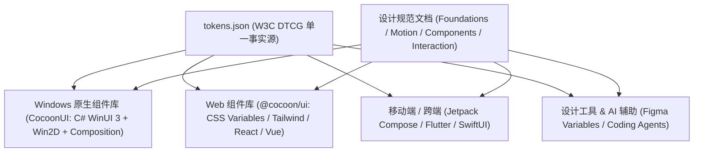

# Cocoon Design System

一套源自掌机前端与触感化硬件界面（3DS / Cocoon 风格）的**跨平台设计系统与组件库规范**。

本系统从 Playrail 的实机验证实现中提炼而来，剥离了所有游戏库与掌机后台业务，以 **平台无关的 Design Tokens + 数学化视觉/动效契约 + 标准化组件接口** 沉淀，既可直接落地为 Windows 原生组件库（WinUI 3 + Win2D / Composition），也可无损映射到 Web（CSS / Tailwind / React / Vue）、Android（Jetpack Compose）、Flutter 或 SwiftUI。

---

## 核心设计原则

1. **软触感立体（Soft Tactile Depth）**
   - 抛弃纯平白块与高饱和霓虹，用极克制的竖向微渐变（`#FDFDFE → #F0F1F4`）、上亮下暗的 1.5 px 描边、双层贴身/落底投影和「灰线 + 白线」凹槽分隔，营造像实体陶瓷或掌机机身一样的厚实、圆润手感。
2. **明确而有生命力的焦点（Concentric Living Focus）**
   - 焦点不是生硬的矩形框，而是与目标圆角**严格同心**的「四角括号」（圆形目标退化为四段断开圆环），带有全局统一 `1.8 s` 周期的蓝紫流光、柔光晕、40% 白边光与移动橡皮筋反馈。
3. **物理可打断动效（Interruptible Spring Physics）**
   - 几乎所有位移、缩放、展开与滚屏均由临界阻尼弹簧（`ζ = 1`）驱动，连按方向键或中途反向操作时从当前速度/位置无缝接管，绝不瞬移或冻在半路。
4. **双模原生共生（Gamepad-First, Touch-Native）**
   - 同时把**手柄/键盘焦点导航**与**手机级直觉触控**做到一等公民：触摸操作即刻隐藏焦点框并支持拖动惯性、越界 1/3 橡皮筋回弹和按下压暗反馈；一旦按下手柄/方向键，焦点框立即平滑回到当前项。
5. **层次清晰、内容克制（Calm Hierarchy）**
   - 分组靠立体卡片与留白自然隔开，避免冗余小标题；遮罩层用统一深灰 `rgba(35, 35, 37, 0.76)` 抬起暗部、压扁反差，保持壁纸纹理可辨的同时让前景组件层轻度模糊（`σ = 8`）退后。

---

## 文档导航

| 文档 | 内容与用途 |
| --- | --- |
| [tokens.json](tokens.json) | **单一事实源（W3C DTCG 格式）**：完整机器可读的设计令牌（色彩、材质渐变、字体与字重规则、间距、圆角、阴影、括号焦点公式参数、弹簧刚度与动效时长），供多端代码生成器、Style Dictionary 或 AI 编码助手直接消费。 |
| [preview.html](preview.html) | **交互式活规范预览（浏览器直接打开）**：基于生成的 `tokens.css` 与同心四角括号焦点引擎搭建，支持键盘方向键 / 手柄导航与触控实测全部基础控件、双栏页面、左右抽屉和焦点算法实验室。 |
| [Build-CocoonTokens.mjs](../../../tools/Build-CocoonTokens.mjs) | **多端 Token 生成器**：从 `tokens.json` 一键生成 C#（[CocoonTokens.g.cs](../../../frontend/cocoon-ui/Tokens/CocoonTokens.g.cs)）、CSS/Tailwind（[tokens.css](../../../packages/cocoon-tokens/dist/tokens.css) / [tailwind.preset.js](../../../packages/cocoon-tokens/dist/tailwind.preset.js)）、Kotlin Compose 与 Flutter Dart 令牌文件。 |
| [foundations.md](foundations.md) | **基础视觉规范**：设计坐标系与 `dp` 换算、完整色彩语义表、4 种核心表面材质、中英混排字重规范（防中文合成加粗发糊）、圆角同心法则、投影与凹槽分隔规范。 |
| [motion-and-focus.md](motion-and-focus.md) | **动效物理与焦点引擎规范**：临界阻尼弹簧数学定义与多端参数换算、四角括号与断开圆环的逐公式几何算法、全局统一 `1.8 s` 周长流光、橡皮筋形变、二级页分层入场与抽屉双段展开编排、降低动态效果降级规则。 |
| [components.md](components.md) | **完整组件库目录与规格**：覆盖基础控件（11 个）、数据可视化组件（4 个）与页面/容器模板（6 个）的尺寸解剖、状态机、Props 数据契约与交互细节。 |
| [interaction-and-layout.md](interaction-and-layout.md) | **双模交互与响应式适配**：手柄按键语义与连发节拍、触控手势与惯性滚动、手柄↔触控切换规则、音效语义契约、多分辨率/多形态设备（掌机 16:10、桌面宽屏、平板、移动端）布局适配指南。 |
| [implementation-guide.md](implementation-guide.md) | **跨端实现与组件库落地方案**：面向 Windows C#（独立 `CocoonUI` NativeAOT 类库 + `CocoonUI.Gallery` 展厅）、Web（CSS Variables / Tailwind / React）、Android Compose / Flutter 的映射方式，以及 Playrail 内部从现有 `WallStage` 渐进抽离的 4 阶段路线图。 |

---

## 目标复用范围

---

## 版本与溯源

- **基线版本**：`1.0.0-draft`（基于 Playrail `0.1.331.15` 实机定稿代码提取核对）
- **参考源码位置**（Playrail 内部迁移前）：`WallStage.Cursor.cs`、`WallStage.CocoonPages.cs`、`WallStage.CocoonPanels.cs`、`WallStage.Cases.Row*.cs`
